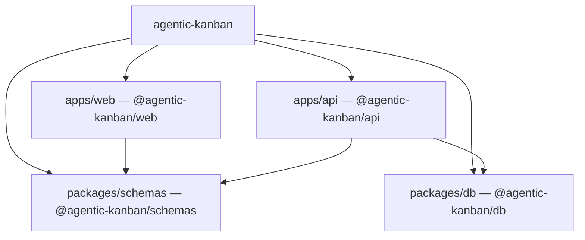
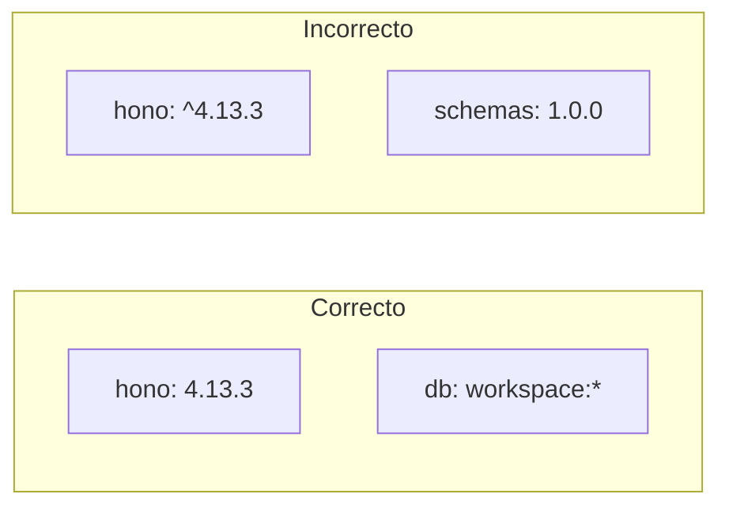

# Dependencias del proyecto

Un monorepo Bun: el root agrupa cuatro paquetes; las flechas internas son `workspace:*`, las externas van **pin exacto** (sin `^`).

- Workspaces: `apps/*` + `packages/*`. Gestor y runtime de la API: **Bun 1.4.0**.
- Interno: `"@agentic-kanban/schemas": "workspace:*"` (nunca una versión publicada).
- Externo: pin exacto (`"hono": "4.13.3"`). Un solo `bun.lock` en la raíz.
- `web` **no** importa `db`. El navegador no habla con libSQL.

> [!tip] Regla de oro
> Interno = `workspace:*`. Terceros = número cerrado. El navegador nunca importa `@agentic-kanban/db`.

| Hoy                                   | Instalado, aún no se usa | Nunca                                     |
| ------------------------------------- | ------------------------ | ----------------------------------------- |
| 4 paquetes, `workspace:*`, `bun.lock` | —                        | Turborepo, Nx, Lerna, `package-lock.json` |

← [Índice](README.md) · [Frontend →](02-tecnologias-frontend.md)
