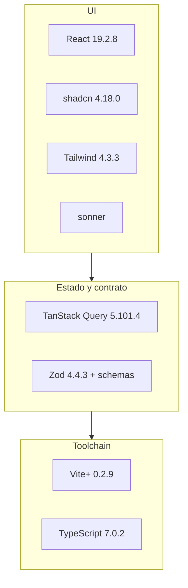
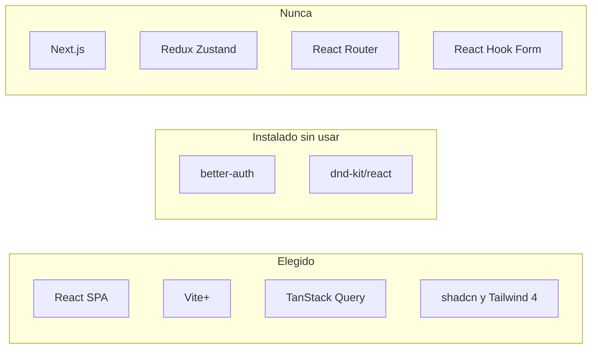

# Tecnologías frontend

SPA en `apps/web`: React pinta, TanStack Query pide, Zod valida, Vite+ sirve. No hay Next ni router.

- Un solo `QueryClient`. Estado de servidor → Query. Estado de UI → `useState`.
- `fetch("/api/health")` **relativo**. Vite+ reenvía `/api` a `API_PROXY_TARGET` (`localhost:3000` o `http://api:3000` en Compose).
- El JSON se trata como `unknown` y se parsea con `healthResponseSchema` (el mismo que usa la API).
- Tailwind 4 entra por plugin de Vite (`@import "tailwindcss"`). No hay `tailwind.config`.
- `next-themes` es el helper de tema, **no** es Next.js.

> [!tip] Regla de oro
> Nunca `fetch("http://localhost:3000/...")`. URL relativa `/api/...` y el proxy de Vite+ hace el resto. Sin CORS.

| Hoy                                  | Instalado, aún no se usa        | Nunca                                            |
| ------------------------------------ | ------------------------------- | ------------------------------------------------ |
| Health screen, Query, Zod `.parse()` | `better-auth`, `@dnd-kit/react` | Next, Redux, React Router, RHF, ESLint, Prettier |

← [Dependencias](01-dependencias.md) · [Backend →](03-tecnologias-backend.md)
