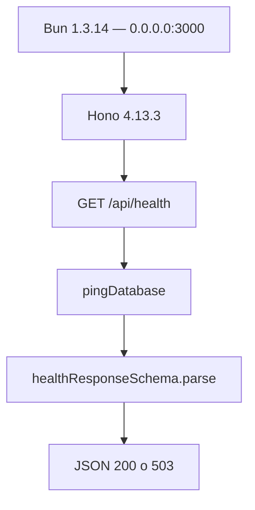
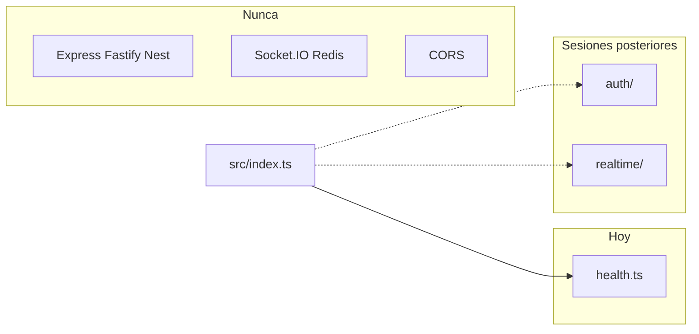

# Tecnologías backend

API en `apps/api`: **Hono sobre Bun**. Un proceso, un puerto, cero CORS. Hoy solo vive `GET /api/health`.

- Runtime = Bun. No Node, no `@hono/node-server`, no Express.
- Cada fichero de rutas es un `new Hono()` y se cuelga con `app.route("/", …)`.
- Validación con `@agentic-kanban/schemas`. Datos **solo** vía `@agentic-kanban/db` (la API no importa Drizzle ni `@libsql/client`).
- Placeholders: `src/auth/` y `src/realtime/`. El realtime futuro se queda **dentro** de este proceso (SSE o WebSocket).
- Hot reload: `bun run --hot`.

> [!tip] Regla de oro
> Sin CORS: el navegador no llama a `:3000`. Llama a `/api` en `:5173` y Vite+ hace de puente.

| Hoy | Instalado, aún no se usa | Nunca |
| --- | --- | --- |
| Hono + Bun, `GET /api/health` | Better Auth, `@hono/zod-validator` (CRUD) | Express, Nest, Node server, Socket.IO, Redis |

← [Frontend](02-tecnologias-frontend.md) · [Base de datos →](04-base-de-datos.md)
