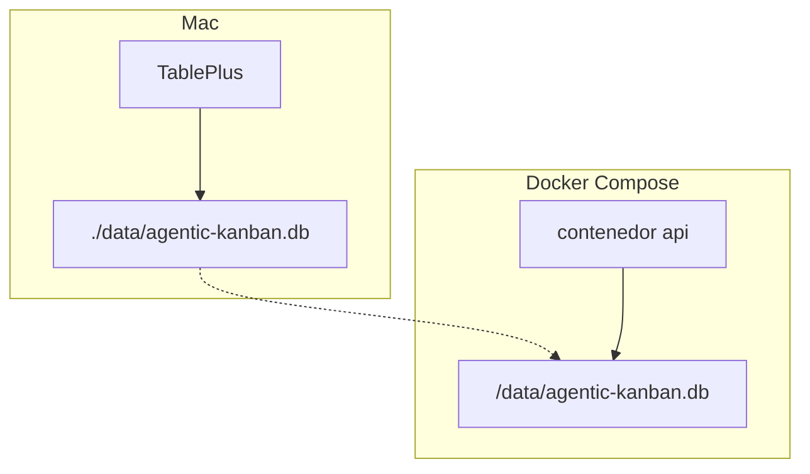

# Base de datos

No hay contenedor de Postgres. Un fichero libSQL en `./data`. Drizzle 0.45 habla con él; el schema de producto está **vacío** a propósito.

- Apertura **lazy** (`getDb()`): Docker monta `/data` _después_ de arrancar el proceso. No conectar al importar.
- `pingDatabase()` = `SELECT 1`. Si el handle está stale, cierra y reintenta una vez.
- drizzle-kit existe (`db:generate` / `db:migrate`) pero **no** se auto-ejecuta.
- TablePlus: abrir el mismo fichero como **SQLite**.

| Dónde      | URL                                                                                  |
| ---------- | ------------------------------------------------------------------------------------ |
| Mac / host | `file:<repo>/data/agentic-kanban.db`                                                 |
| Compose    | `DATABASE_URL=file:/data/agentic-kanban.db` (`./data` → `/data`, **no** `/app/data`) |

> [!danger] Un solo proceso contra el `.db`
> No arranques la API del Mac mientras Compose está arriba. Los dos bloquearían el mismo fichero.

> [!warning] Reset
> `docker compose down` **no** borra datos. Para resetear: `rm -f data/*.db data/*.db-*`. Nunca subas `*.db` a git.

| Hoy                                      | Instalado, aún no se usa         | Nunca                                           |
| ---------------------------------------- | -------------------------------- | ----------------------------------------------- |
| Fichero libSQL, `SELECT 1`, schema vacío | drizzle-kit (cuando haya tablas) | Postgres, Prisma, Turso Cloud, `better-sqlite3` |

← [Backend](03-tecnologias-backend.md) · [Monorepo →](05-monorepo.md)
