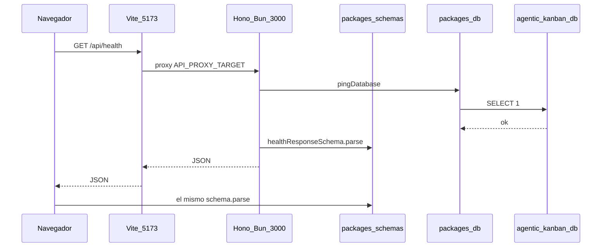
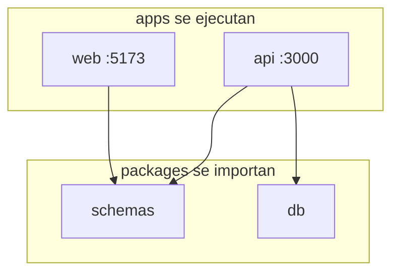
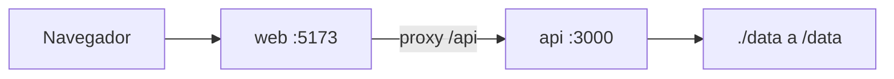

# Cómo se interconecta el monorepo

Misma petición, cuatro paquetes. El navegador pide `/api/health`; Vite+ reenvía; Hono pingea el `.db`; **el mismo Zod** valida el JSON en API y otra vez en web.

Compose: **dos** servicios. El `.db` es un bind-mount, no un tercer contenedor.

> [!tip] Regla de oro — capas (no las mezcles)
> TypeScript tipa · Zod valida · Better Auth autentica *(luego)* · la API autoriza *(luego)* · `workspace_id` aísla *(luego)*. Detalle en [Capas](06-capas.md). **El navegador nunca decide autorización.**

| Hoy | Instalado, aún no se usa | Nunca |
| --- | --- | --- |
| Health de punta a punta, 2 contenedores | Auth, workspaces, tablero | Microservicios, cola, Redis, contenedor de DB |

← [Base de datos](04-base-de-datos.md) · [Capas →](06-capas.md)
