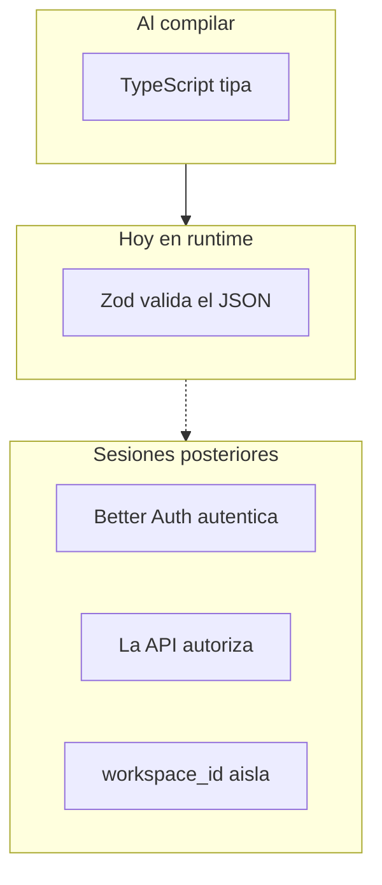
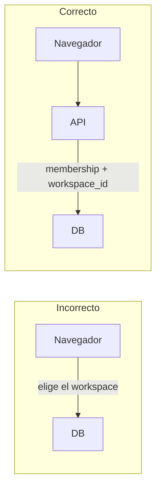

# Capas de responsabilidad

Cinco capas distintas. Mezclarlas es el error típico del curso: un tipo de TypeScript no autentica, Zod no autoriza, y el navegador no decide el tenant.

| Capa          | Quién                                | Qué hace                          |
| ------------- | ------------------------------------ | --------------------------------- |
| Tipos         | `tsc` / Vite+                        | Forma en compile-time             |
| Contrato      | `@agentic-kanban/schemas`            | `.parse()` en API **y** en web    |
| Autenticación | Better Auth en `apps/api/src/auth/`  | Quién eres                        |
| Autorización  | Checks de membership en la API       | Si puedes entrar a ese workspace  |
| Tenant        | `workspace_id` en cada query Drizzle | No cruzar datos de otro workspace |

> [!tip] Regla de oro
> El navegador nunca decide autorización ni tenant. Puede mostrar UI; la API es quien deja pasar y quien filtra por `workspace_id`.

> [!warning] Hoy vs luego
> Health solo usa TypeScript + Zod. Login, membership y `workspace_id` **aún no existen**. No los inventes en el cliente.

| Hoy                                     | Instalado, aún no se usa                | Nunca                                              |
| --------------------------------------- | --------------------------------------- | -------------------------------------------------- |
| TS estricto + el mismo Zod en web y API | Better Auth, membership, `workspace_id` | Authz en el navegador, RLS de Postgres, RBAC extra |

← [Monorepo](05-monorepo.md) · [Índice](README.md)
