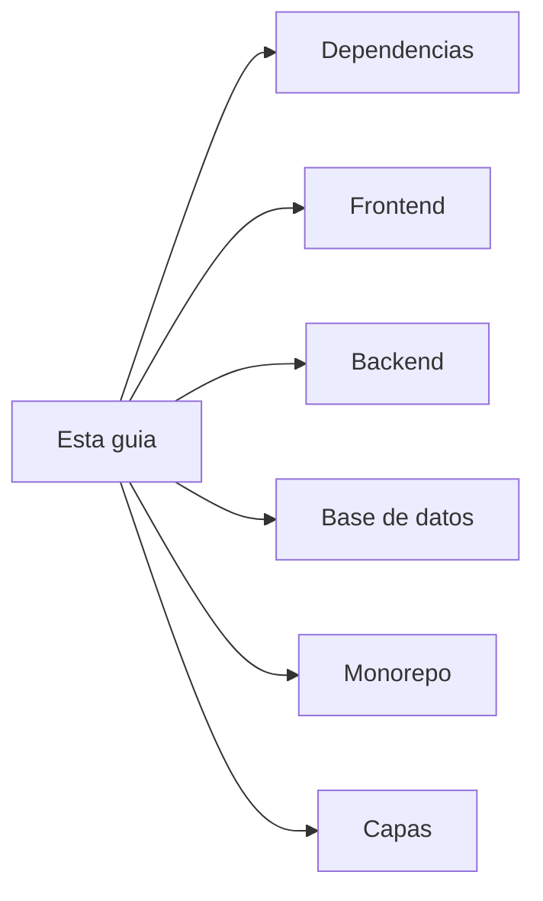

# Agentic Kanban — guía visual

Esqueleto del curso **thePower — Desarrollo Agéntico**. Cuatro paquetes, un fichero SQLite, una ruta: `GET /api/health`.

| #   | Ficha                                              | Pregunta de clase                          |
| --- | -------------------------------------------------- | ------------------------------------------ |
| 1   | [Dependencias](01-dependencias.md)                 | ¿Quién importa a quién?                    |
| 2   | [Tecnologías frontend](02-tecnologias-frontend.md) | ¿Qué hay en el navegador y por qué?        |
| 3   | [Tecnologías backend](03-tecnologias-backend.md)   | ¿Qué hay en el servidor y por qué?         |
| 4   | [Base de datos](04-base-de-datos.md)               | ¿Dónde vive el `.db` y quién lo toca?      |
| 5   | [Monorepo](05-monorepo.md)                         | ¿Cómo viaja una petición de punta a punta? |
| 6   | [Capas](06-capas.md)                               | ¿Quién tipa, valida, autentica y autoriza? |

> [!info] Cómo usar estas fichas
> Ábrela en **Obsidian** (Mermaid y callouts van de serie). Lee el diagrama primero, luego los bullets. No hay login, tablero ni CRUD: eso llega en sesiones posteriores.

> [!tip] Arranque de aula
> `docker compose up --build` → app en `http://localhost:5173` → API en `http://localhost:3000/api/health`.
